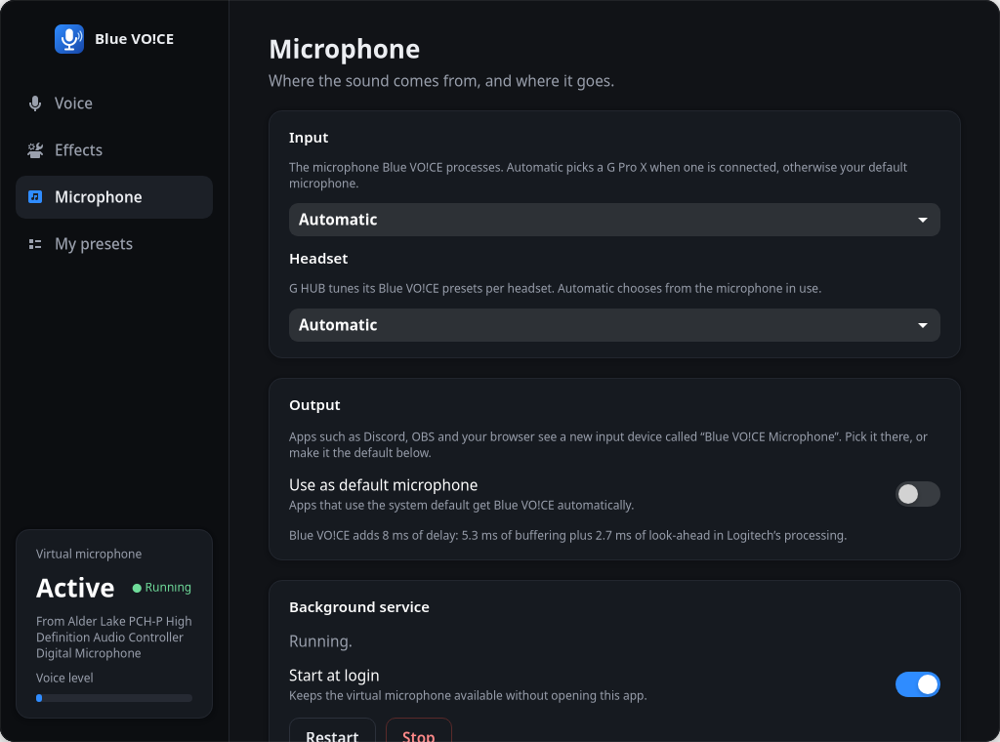

# Blue VO!CE for Linux

I use a Logitech G Pro X, and the one thing I missed after moving to Linux was Blue VO!CE.
G HUB only runs on Windows, so I took it apart to see where Blue VO!CE actually lives.

Turns out it isn't in the headset at all. It's a Windows audio effect that G HUB installs, a
DLL built on DTS's MicOpt library. This project loads that same DLL on Linux, without Wine,
and puts the result on a virtual microphone. Same code Logitech ships, so it sounds the same:
I checked all 22 presets against the Windows effect and the output is identical, sample for
sample.


## What you get

A new input device called **Blue VO!CE Microphone** that Discord, OBS, your browser or anything
else can use, plus a small app to control it:

- every Blue VO!CE preset G HUB has for the G Pro X (and the Pro X Wireless set too)
- all the advanced controls: high-pass, noise reduction, noise gate, voice EQ, de-esser,
  compressor and limiter. Changes apply while you talk, without clicks
- save your own presets, import and export them
- an on/off switch that keeps the device around, so your apps don't lose their mic

It runs in the background, so you can close the app. Your real microphone is only opened while
some app is actually recording from Blue VO!CE.

| Effects | Microphone |
| --- | --- |
|  |  |

## Install

```bash
git clone https://github.com/HolyJoey/Lghub.git
cd Lghub
./install.sh
```

You need an x86-64 PC with PipeWire, Python with GTK 4 and libadwaita, and gcc to build the
helper:

| Distro | Packages |
| --- | --- |
| Debian / Ubuntu | `python3-gi gir1.2-gtk-4.0 gir1.2-adw-1 gcc libpipewire-0.3-dev` |
| Fedora | `python3-gobject gtk4 libadwaita gcc pipewire-devel` |
| Arch | `python-gobject gtk4 libadwaita gcc libpipewire` |

The installer downloads Logitech's files from G HUB's own update server (they aren't in this
repo), checks their hashes, builds the helper, adds a menu entry and starts a user service. No
root needed. `./uninstall.sh` undoes all of it.

Then open **Blue VO!CE** from your menu, pick a preset, and select *Blue VO!CE Microphone* in
your voice app. Or flip *Use as default microphone* and skip that step.

## Is it heavy?

No. While you're talking it uses about 4% of one CPU core and 7 MB of memory; when nothing is
recording it's close to zero. It adds 8 ms of delay and doesn't change how the rest of your
audio runs, so games aren't affected.

## How it works

The Windows effect (`logi_audio_dts_studio_capture_apo.dll`) exports the DSP directly:
`dts_micopt_init`, `dts_micopt_set`, `dts_micopt_process` and a few more. So instead of
emulating the Windows audio engine, `bridge/peloader.c` maps the DLL into a normal Linux
process and gives it the handful of Windows functions that code path needs.
`bridge/micopt.c` calls it the way the Windows effect does: 256-frame blocks, the same
defaults, and the same quirks (on/off switches go in as integers, not floats). The
`bluevoice-bridge` program wraps that in a PipeWire filter.

`engine.py` is the background service. It starts the bridge, connects your mic to it when an
app is listening, and applies whatever you change in `app.py`.

Every parameter, its unit and its default is written down in
[docs/apo-parameters.md](docs/apo-parameters.md).

To check the result, `host/bluevoice_host.c` loads the same DLL the way Windows does (as a COM
audio effect, under Wine) and `host/compare_native.py` feeds both the same recording.

## If something's off

`systemctl --user status lghub-bluevoice` and `journalctl --user -u lghub-bluevoice` show what
the service is doing. If the installer says a download doesn't match, Logitech has released a
new version of the files; open an issue. If you have the files from somewhere else you can
point the installer at them with `./install.sh --depot-dir DIR`.

## Notes

Not affiliated with Logitech. Blue VO!CE, G HUB and G Pro X are Logitech's trademarks, DTS is
DTS, Inc.'s. This repo only has my own code; Logitech's files are downloaded from Logitech when
you install and stay on your machine.
