# Lghub

Lghub is Logitech G HUB, reverse-engineered for Linux: the settings G HUB gives you for
Logitech G headsets, mice, keyboards and webcams, running natively (no Wine). Where G HUB's
features are Logitech's own code, like Blue VO!CE and DTS surround, Lghub runs that same code
from G HUB's packages; everything else talks to the devices directly, the way G HUB does.
Devices show up as you plug them in, including wireless ones behind a LIGHTSPEED, Unifying or
Bolt receiver and ones connected over Bluetooth; pick one to change its settings. New
mice and keyboards pair to a LIGHTSPEED receiver from the app (Settings).

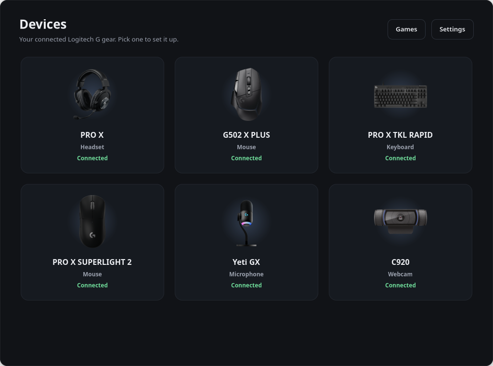

## Headsets

The G Pro X, G Pro X Wireless and G733 open on Blue VO!CE; other headsets get the page
described under *Keyboards and the rest*.

**Blue VO!CE.** Logitech's own voice processing (it runs the DTS code G HUB ships, so all
presets sound exactly as on Windows), on a new input device called *Blue VO!CE Microphone*
that Discord, OBS, your browser or anything else can use:

- every Blue VO!CE preset G HUB has for the headset
- all the advanced controls: high-pass, noise reduction, noise gate, voice EQ, de-esser,
  compressor and limiter. Changes apply while you talk, without clicks
- your own presets, with import and export
- an on/off switch that keeps the device around, so your apps don't lose their mic

It keeps running in the background, and your real mic is only opened while some app is
recording from Blue VO!CE.

**Equalizer.** G HUB's 10-band headset equalizer presets (Flat, FPS, MOBA, Bass Boost,
Cinematic, Communications) and bands, 32 Hz to 16 kHz, on a new output *… (Equalizer)* in front of the
headset. The presets come from Logitech's own files; the filters doing the work are PipeWire's,
not Logitech's DSP.

**Blue VO!CE 2.** On Yeti mics (Yeti GX and Orb too), the G735 and the PRO X 2, the newer voice chain G HUB runs there
(Logitech's own DTS ClearVoice 2 processing), with G HUB's presets for the mic (Broadcaster,
High Voice, Warm and Vintage, ...) and a switch for each stage: high-pass, noise reduction,
noise gate, compressor, equalizer, de-popper, de-esser, limiter, each with G HUB's own controls.
Plus G HUB's voice effects (Robot, Helium Chipmunk, Demon, ...: voice changer, chorus, flanger,
reverb, delay, ring modulator). Untested on a real Yeti.

**Games.** Settings that switch on while a game runs, like G HUB's game profiles: add a game by
its executable (Proton games too) or Steam App ID, or pick from the installed games (Steam, Heroic, Lutris), and its Blue VO!CE, equalizer and surround
settings come on when it starts and go back when it closes, with a desktop notification each
time (can be turned off).

| Blue VO!CE 2 (Yeti X) | Games |
| --- | --- |
| 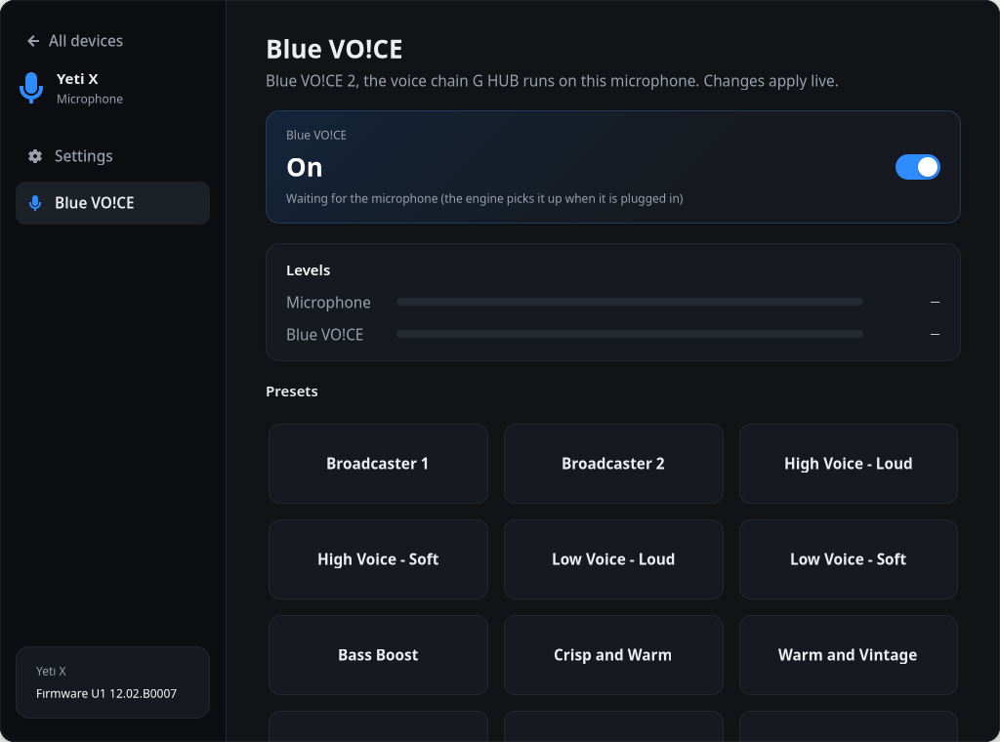 | 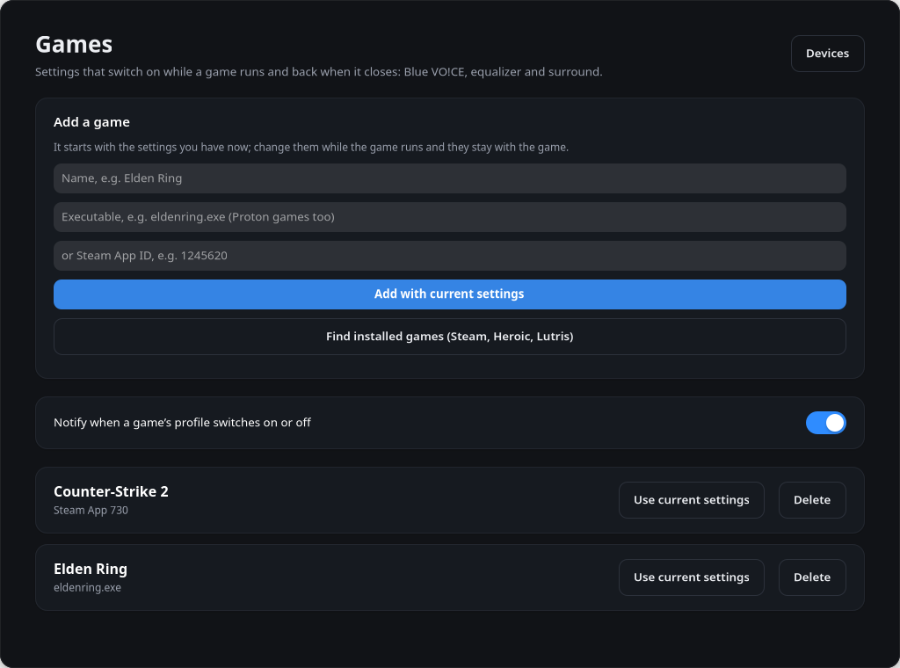 |

**Surround.** G HUB's DTS Headphone:X 2.0 virtual 7.1, running Logitech's own DTS processing
with your headset's tuning (G Pro X, G Pro X Wireless, G733 and more), on a new output
*… (Surround 7.1)*. Games set to 7.1 get every speaker placed around you. G HUB's rooms
(Gaming, Entertainment, Sports) and per-channel volumes. It only runs while something plays, and it works together with the equalizer.

**Headset.** Sidetone, volume and mic level from the headset's sound card, plus lighting,
battery and the equalizer built into the headset (works on any computer or console) on headsets
that have them.

| Voice | Effects |
| --- | --- |
| 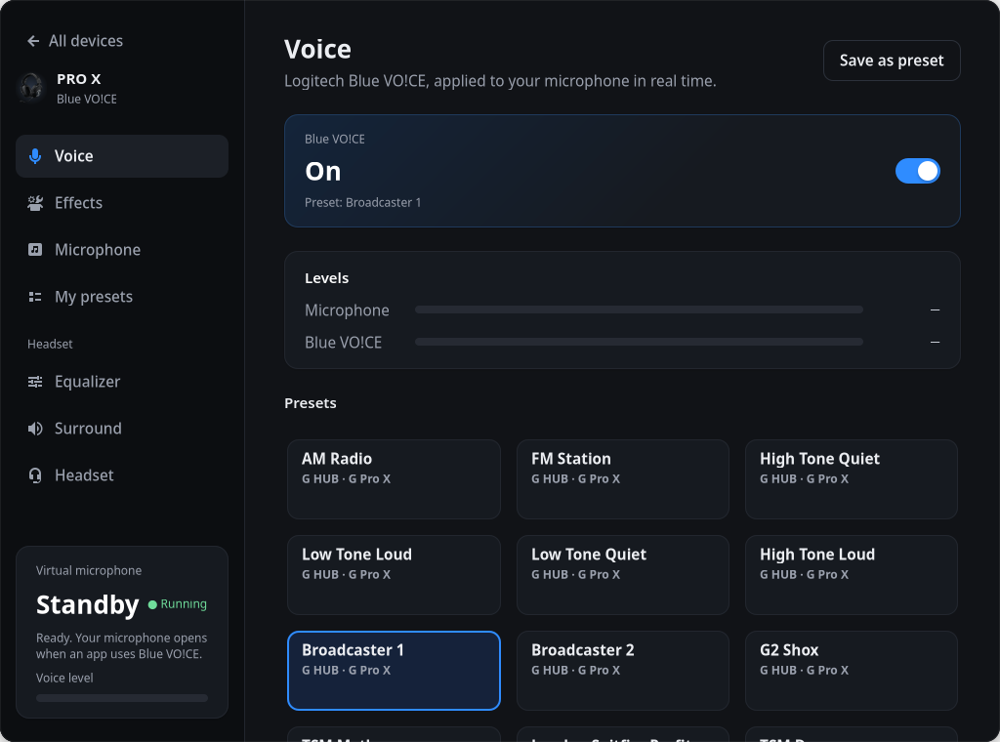 | 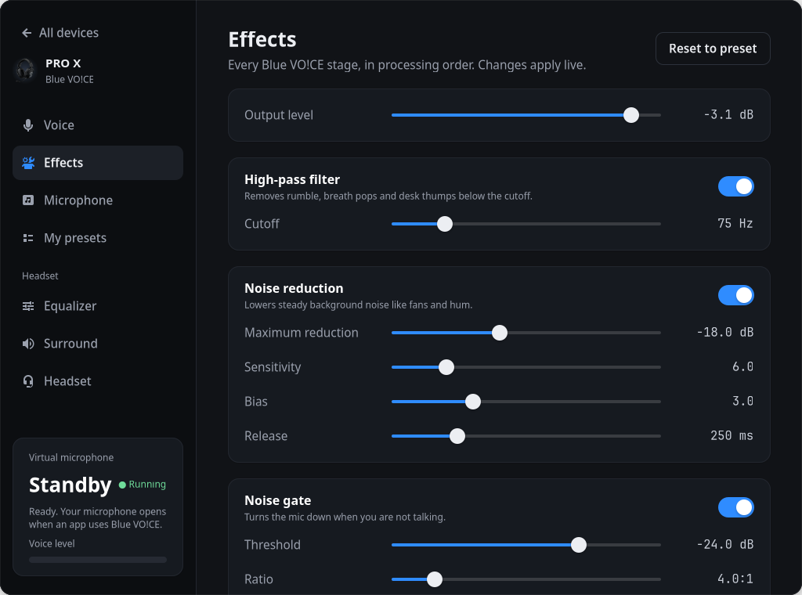 |
| **Equalizer** | **Surround** |
| 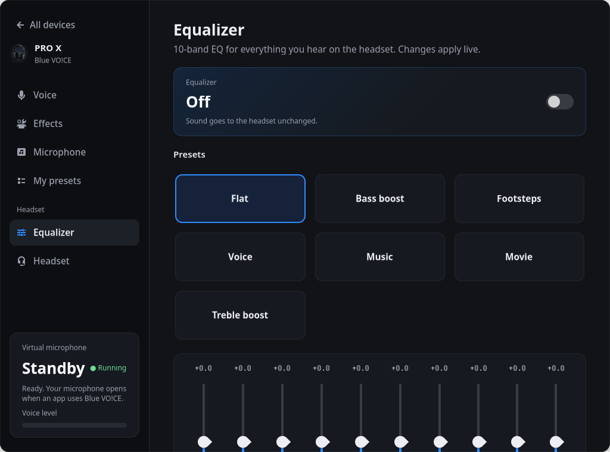 | 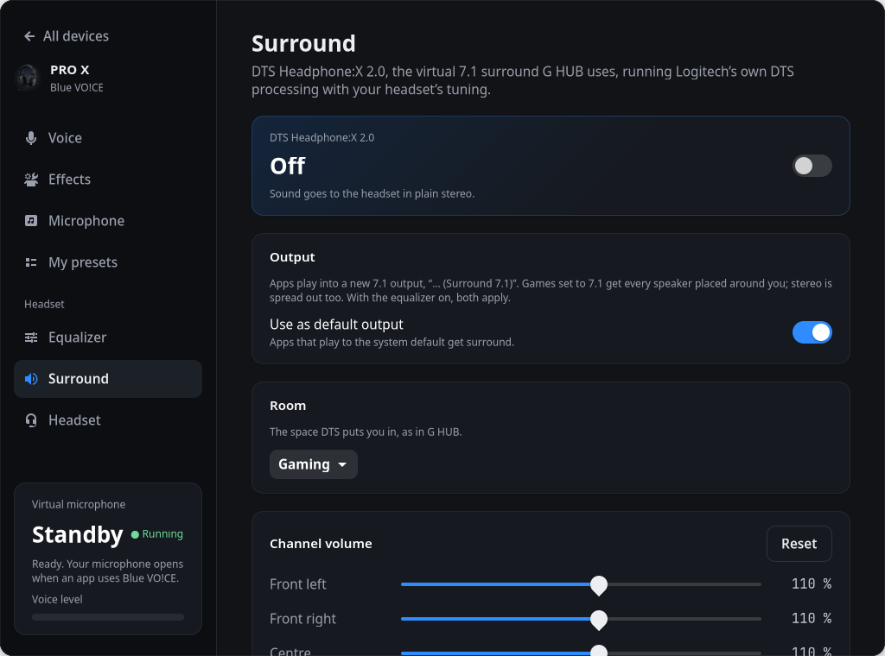 |

## Mice

DPI levels (and the default and DPI-shift level), report rate, what every button does
(including keystrokes and a G-Shift layer), lighting, and the profiles stored in the mouse.
Lghub knows the models G HUB 2026.6 lists (mice, keyboards, headsets, webcams, mics, Litra
lights), with G HUB's own ids, lighting zones and capabilities. Models it doesn't know yet show
under the name they give.
Mice that have them also get the scroll wheel (ratchet or free spin, SmartShift, ratchet
force), bunny hopping, surface tuning, angle snapping, left-handed buttons and hybrid tracking; newer mice get
their 2-8 kHz report rates and extended DPI range.
**Macros** like G HUB's: keystrokes, text, media and system actions, apps, web pages and
recorded sequences (once, while held, or on/off), put on any button but the left one. They
run in the background service, the same way G HUB does it (HID++ 0x8110, or 0x1B04 on newer
mice like the G502 X: only buttons with a macro stop clicking by themselves). DPI and profile macros switch the mouse's own DPI and
profiles. G HUB's audio actions (cycle equalizer, toggle surround, cycle output or input, mic
gain and volume, sidetone and bass, switch to the headset) work with any headset and show a
short notice.
When the mouse's own buttons switch DPI, profile or report rate, a short desktop notice shows the new value,
as G HUB's on-screen display does.
Like G HUB's on-board memory mode, everything is saved *in the mouse*, so it keeps working on
any computer and nothing has to run in the background. Before the first change, the mouse's
memory is backed up to `~/.local/share/lghub/backups/`.

| Sensitivity | Buttons | Lighting |
| --- | --- | --- |
| 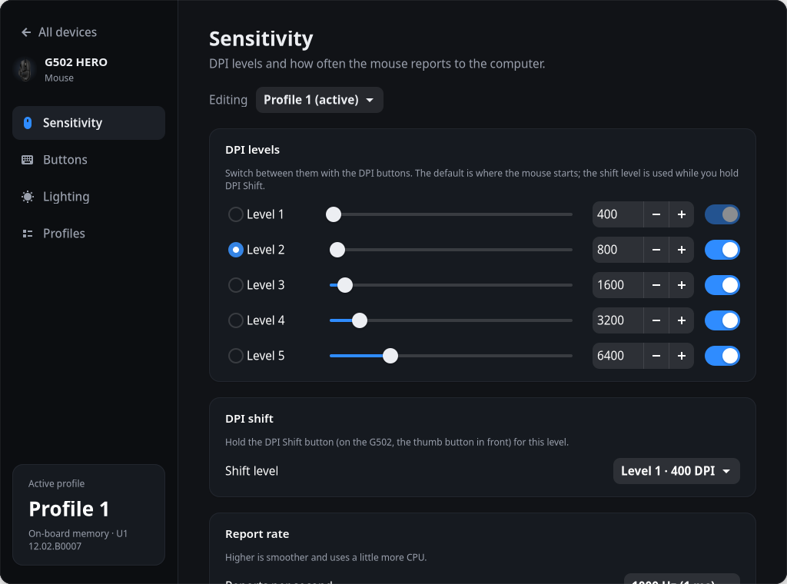 | 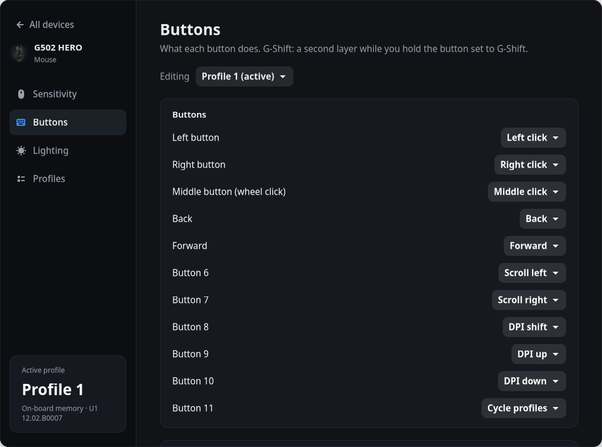 | 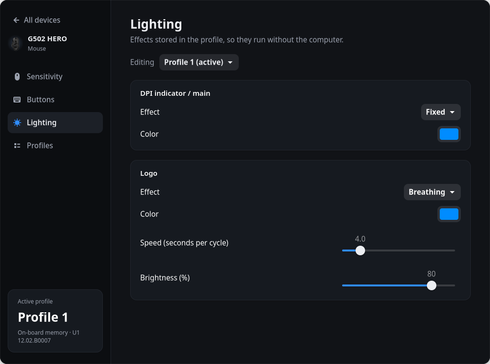 |

Wireless mice also show their battery (devices that only report a voltage get G HUB's own
voltage curves), with a desktop notification when it gets low, as G HUB does.

## Keyboards and the rest

Keyboards, other headsets, the G560 speakers, POWERPLAY and anything else Logitech: Lghub
asks the device what it can do and shows that. Keyboards also get macros on their G-keys (three sets, switched with M1-M3) and a
per-key lighting page drawn from G HUB's own key layout, sent over HID++ 0x8081 with G HUB's
key-to-LED table (0x8080 on older keyboards), with G HUB's LIGHTSYNC effects: its own animations (Verticool, Contrastic, Ocean Wave, Lightning, Red White
and Blue), starlight, colour cycle, echo press, your own animations (made in a Freestyle-like editor), the audio visualizer and the screen sampler (its regions editable as in G HUB: move, add, delete, which keys go where; it reads the screen with
grim on Hyprland, Sway and other wlroots compositors, else through the desktop's screen-sharing
portal on GNOME and KDE, which asks once; that needs GStreamer's PipeWire plugin,
`gstreamer1.0-pipewire`). Lighting zones and effects, brightness, report
rate, Fn keys, game mode, Easy-Switch, power-saving and power-off timers, angle snapping, sidetone, on-board memory and battery. Analog keyboards (PRO X TKL RAPID, G515 RAPID and the
like) get G HUB's rapid trigger and key priority switches. Devices with a USB sound card (headsets,
speakers, Yeti mics) also get its controls. Yetis also get their own mute, gain, headphone level and mic monitoring over HID++,
as G HUB sets them.

| Settings | Per-key lighting |
| --- | --- |
| 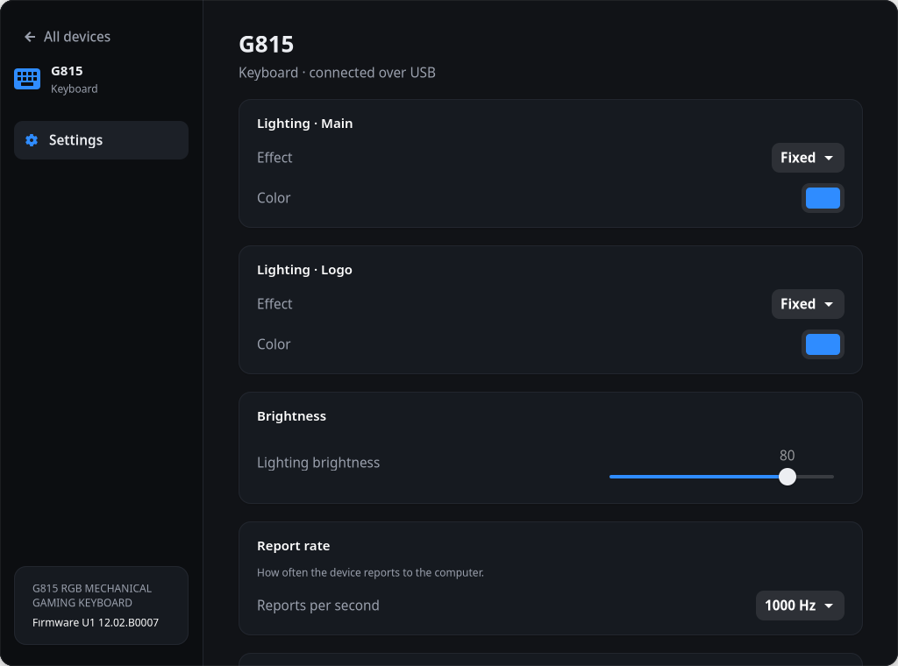 | 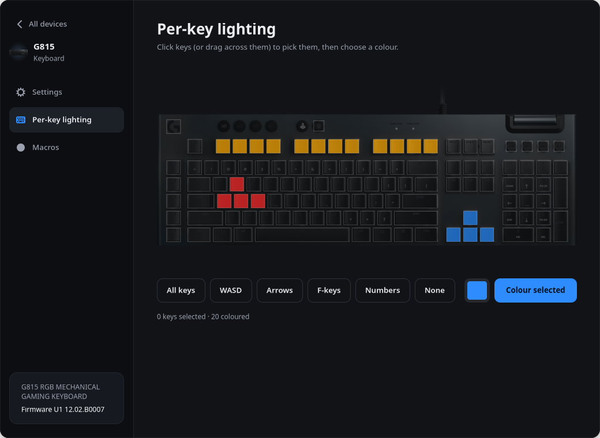 |

## Webcams

A live preview, and every setting the camera has: brightness, contrast, saturation,
sharpness, white balance, exposure, focus, zoom, pan and tilt. Webcams forget their settings
when unplugged, so Lghub saves them and puts them back whenever the camera shows up again.

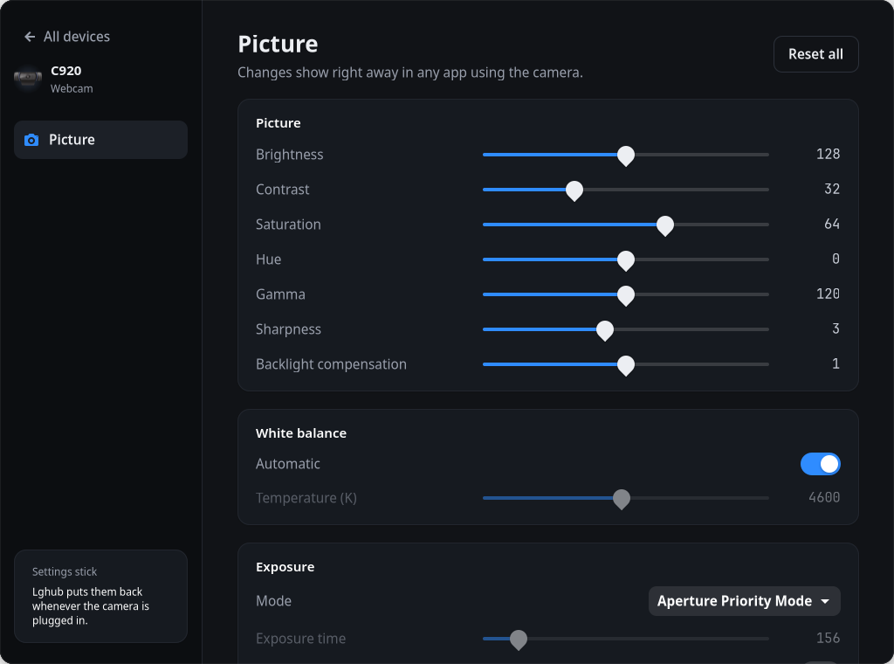

## Install

```bash
git clone https://github.com/HolyJoey/Lghub.git
cd Lghub
./install.sh
```

You need an x86-64 PC with PipeWire, Python with GTK 4, libadwaita and cryptography, and gcc to
build the Blue VO!CE helper:

| Distro | Packages |
| --- | --- |
| Debian / Ubuntu | `python3-gi gir1.2-gtk-4.0 gir1.2-adw-1 python3-cryptography gcc libpipewire-0.3-dev alsa-utils` |
| Fedora | `python3-gobject gtk4 libadwaita python3-cryptography gcc pipewire-devel alsa-utils` |
| Arch | `python-gobject gtk4 libadwaita python-cryptography gcc libpipewire alsa-utils` |

PipeWire has to be the running sound server (the default on current distributions) and the
service runs under systemd's user session. The installer checks all of this. On Debian, Ubuntu,
Fedora, Arch and their derivatives it shows the exact command for anything missing and asks
before running it (the default is no); elsewhere it lists what to install. Optional extras get
their own question: grim (Hyprland, Sway) or GStreamer's PipeWire plugin (GNOME, KDE) for the
screen sampler, and on GNOME the AppIndicator extension for the tray icon.

The installer downloads Logitech's audio effects (Blue VO!CE and DTS Headphone:X), G HUB's
equalizer presets and G HUB's app icon from G HUB's own update server (none of it is in this
repo), checks the hashes, builds the helpers, adds a menu entry and starts a user service. `./uninstall.sh` undoes all of it. Later, the first time a device shows up, the
app fetches its product picture from the same server (and, for the G733, its Blue VO!CE
presets): just those files, a few hundred KB to a few MB. Newer models' packages are
encrypted; Lghub fetches the keys from the same server, as G HUB does, and decrypts only the
files it needs.

Mice and keyboards need permission to talk to the device, and macros to type. One udev rule
file does both; this is the only step that needs root. The installer shows these commands and
offers to run them when the rule isn't there yet (or is from before Bluetooth support):

```bash
printf '%s\n' 'SUBSYSTEM=="hidraw", ATTRS{idVendor}=="046d", TAG+="uaccess"' \
  'SUBSYSTEM=="hidraw", KERNELS=="0005:046D:*", TAG+="uaccess"' \
  'KERNEL=="uinput", SUBSYSTEM=="misc", TAG+="uaccess", OPTIONS+="static_node=uinput"' \
  | sudo tee /etc/udev/rules.d/70-lghub.rules
sudo udevadm control --reload && sudo udevadm trigger
```

The second line is for devices connected over Bluetooth (G604, G915 and the others G HUB lists
with a Bluetooth id); they show up next to the USB ones.

Then open **Lghub** from your menu (or run `lghub`).

## Updates

Once a day the background service asks GitHub for the newest Lghub release (nothing else is
sent; Settings turns it off or checks now). When there is one, the Devices page shows a banner:
**What's new…** shows the release notes and **Update now** installs it. Lghub checks the
download's SHA-256 and that it is signed with the release key in this repo (`release-key.pub`),
backs up its own program files, runs the new `install.sh` and puts the backup back if anything
fails. If the new version needs something only an administrator can install, it says so and
shows the command. Copies run from a git checkout or a distribution package only get the notice.

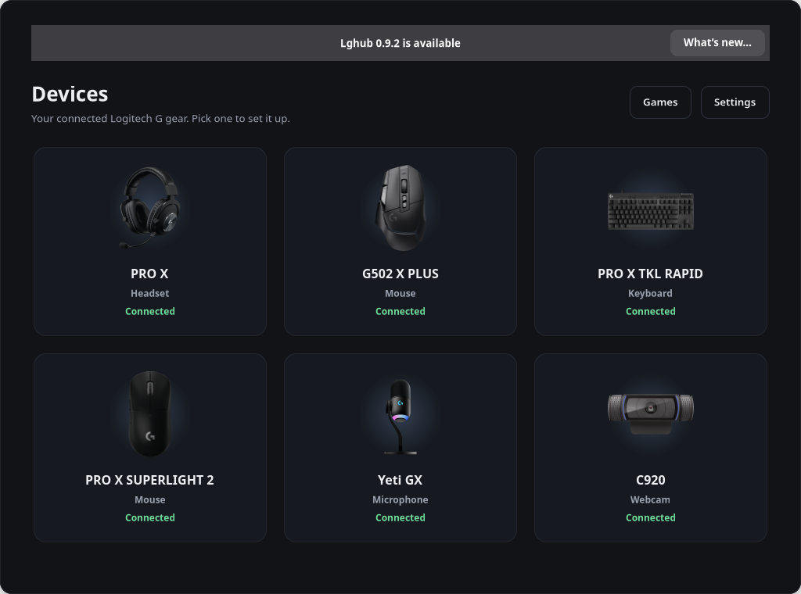

## Tray

Like G HUB, the background service puts an icon in the tray (waybar, KDE, GNOME with the
AppIndicator extension): your devices with their battery, switches for Blue VO!CE, the equalizer
and surround, Open Lghub, and Quit Lghub (closes the window and stops the background service
until the next login). The Settings page (from the home screen) turns it off, along with
each kind of notification, and sets a persistent profile (one game profile that stays on, as in
G HUB).

## Is it heavy?

No. Measured on a laptop (Intel Alder Lake), as a share of one CPU core:

| Part | While in use | Otherwise |
| --- | --- | --- |
| Background service (keeps everything below running) | | 0.2%, 28 MB |
| Blue VO!CE | about 4% while you talk, 8 ms delay | nothing: your mic is only opened while an app records |
| Surround | about 1.5% while something plays | nothing: the headset can go idle |
| Equalizer | about 0.5% while something plays | nothing (and not running when switched off) |
| Webcam preview | about 5% in the app while it shows | nothing (off, or app closed) |
| Mice, keyboards | | nothing: their settings are stored in the device |

The app itself does nothing once closed.

## How it works

- **Devices.** Mice, keyboards, headsets and mics are driven over HID++ the way G HUB drives
  them. Every feature, byte layout and G HUB default Lghub uses is written down in
  [docs/protocol.md](docs/protocol.md), for anyone building on it.
- **Surround.** The DTS Headphone:X effect (`logi_audio_hx2e_render_apo.dll`) doesn't export
  its DSP, but the C++ object that holds it has a plain vtable: `bridge/hx2e.c` creates it with
  the DLL's own factory and calls Init (the headset's tuning), SetStreamsParams and Process
  the way G HUB's effect does. `surround-bridge` puts that behind a 7.1 PipeWire output.
- **Blue VO!CE.** The Windows effect (`logi_audio_dts_studio_capture_apo.dll`) exports its DSP
  directly. `bridge/peloader.c` maps the DLL into a normal Linux process and gives it the few
  Windows functions it needs; `bridge/micopt.c` calls it the way the Windows effect does, and
  `bluevoice-bridge` wraps that in a PipeWire filter. Every parameter is written down in
  [docs/apo-parameters.md](docs/apo-parameters.md). The output was checked sample by
  sample against the real effect running under Wine.
- **Mice, keyboards, receivers.** Logitech's HID++ 2.0 protocol over `/dev/hidraw`
  (`hidpp.py`): ask the device which features it has, then use them. Onboard profiles
  (`mouse.py`) are read, changed and written back with their checksum, then read again to
  make sure.
- **Webcams.** The standard Linux video interface, V4L2 (`v4l2.py`), for the settings and
  the preview (MJPEG frames, decoded by GTK).
- **Headset sound card.** ALSA's mixer (`headset.py`).
- **Background service.** `engine.py` keeps Blue VO!CE, the equalizer and surround running and
  puts webcam settings back. `systemctl --user status lghub` shows it.

Which device is which comes from a table of model facts (`devices.py`): USB ids, lighting
zones, and so on, from G HUB's own device list. `depots.py` knows where each model's G HUB
package lives and reads just the files it needs out of it with HTTP range requests. Newer
packages are encrypted (AES-128-GCM, the IV from each file's hash); `depots.py` decrypts the
files it reads with the keys G HUB's update server hands out to G HUB itself, and checks each
file against its hash.

## Trying it without the hardware

```bash
LGHUB_FAKE_DEVICES=0aaa,c08b,c539,c33f,c35b,082d lghub
```

pretends a G Pro X, a G502 HERO, a receiver with a G502 LIGHTSPEED, a G815, a PRO X TKL RAPID
and a C920 are plugged in. Mice and keyboards are simulated (`simulate.py`), and the tests run against the
same simulator: `python3 -m unittest discover tests`. `082d@3-4` makes the camera on USB port
3-4 pose as a C920. The mouse, keyboard and wireless screenshots above are from the
simulator. The webcam screenshot is a real camera.

## Not there yet

- Most devices here have only met the simulator. If something doesn't work on yours (or does),
  open an issue with the "Device report" form: it asks for the model, the service log
  (`journalctl --user -u lghub`) and what the device's page says.
- Still open, compared with G HUB: the 5-band PRO equalizer, the G735 / PRO X 2 protocol and
  the newer headsets' settings (A50 X, G522, PRO X3), Blue VO!CE on the newer devices, per-key
  actuation on analog keyboards, receiver pairing, keyboard onboard-profile editing and a few
  newer-mouse features. The full list is in [TODO.md](TODO.md).

## If something's off

`systemctl --user status lghub` and `journalctl --user -u lghub` show what
the service is doing. If a mouse or keyboard page says it can't talk to the device, check the
udev rule above and replug it. If the installer says a download doesn't match, Logitech has
released new files; open an issue. If you have the files from somewhere else, point the
installer at them with `./install.sh --depot-dir DIR`.

## License

MIT, see [LICENSE](LICENSE). That covers the code in this repo. Logitech's files that Lghub
downloads (the Blue VO!CE and DTS Headphone:X effects, Blue VO!CE and equalizer presets,
product pictures and the G HUB icon) are not part of it and stay under Logitech's own terms.

Not affiliated with Logitech. Logitech, G HUB, Blue VO!CE, LIGHTSPEED, the G HUB icon and the
product names are Logitech's trademarks; DTS and DTS Headphone:X are DTS, Inc.'s.
